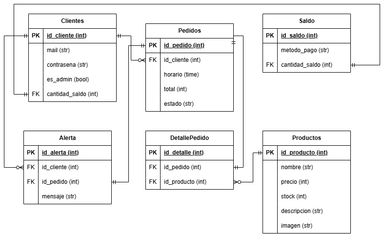
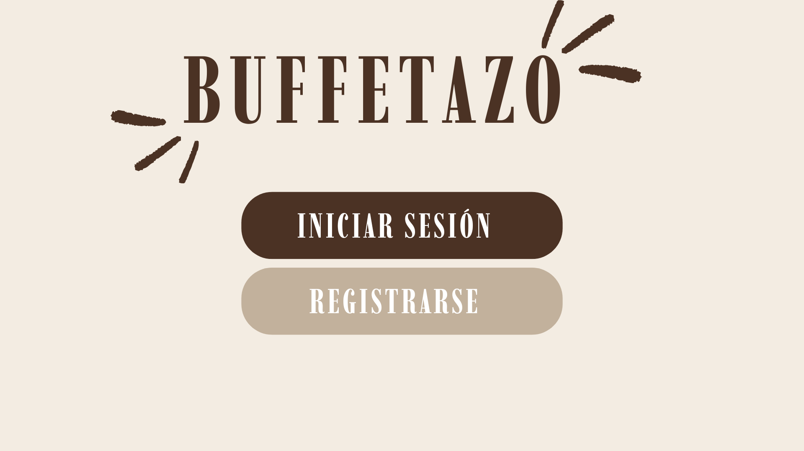
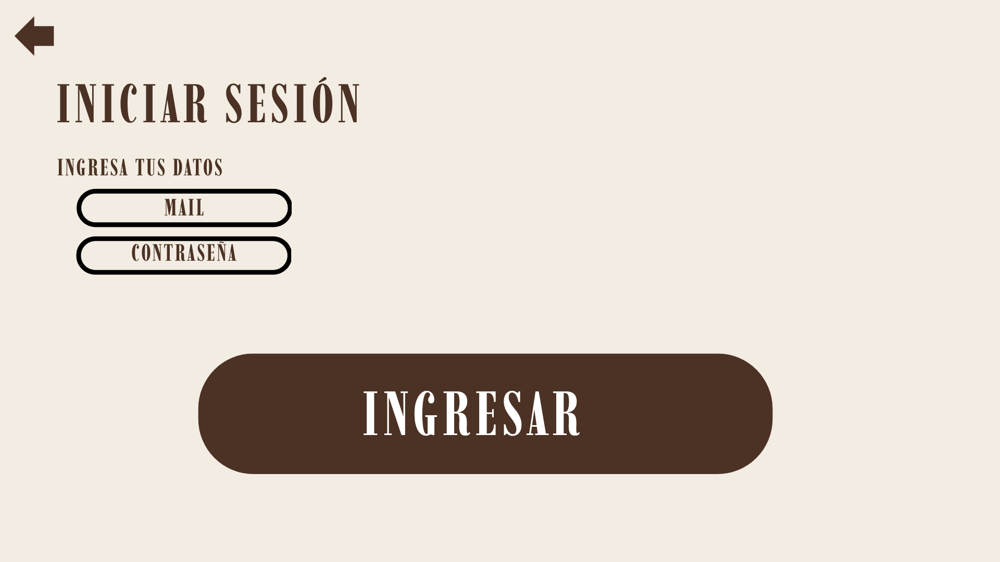
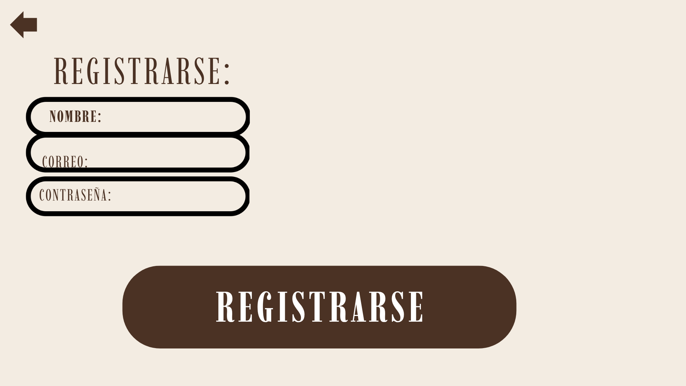
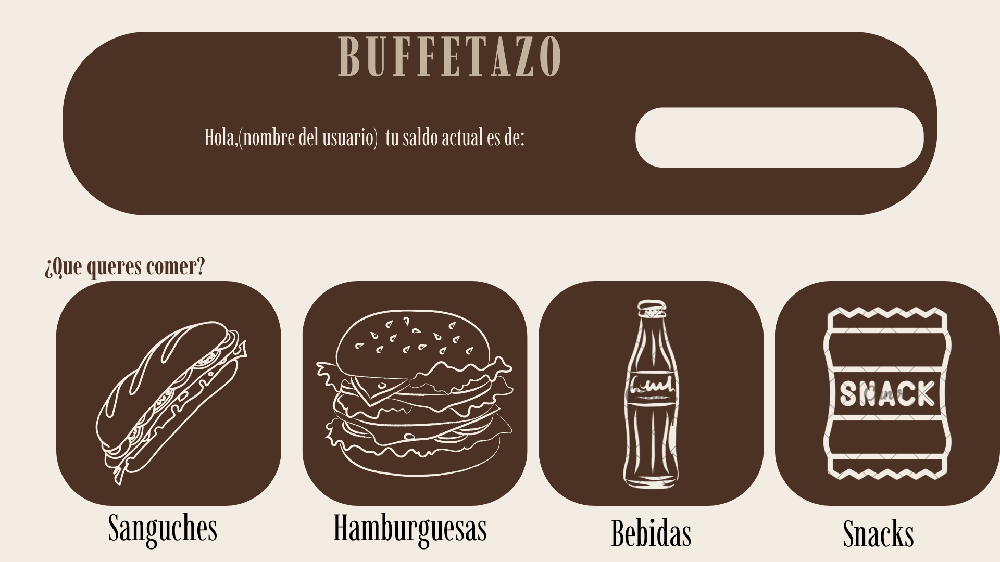
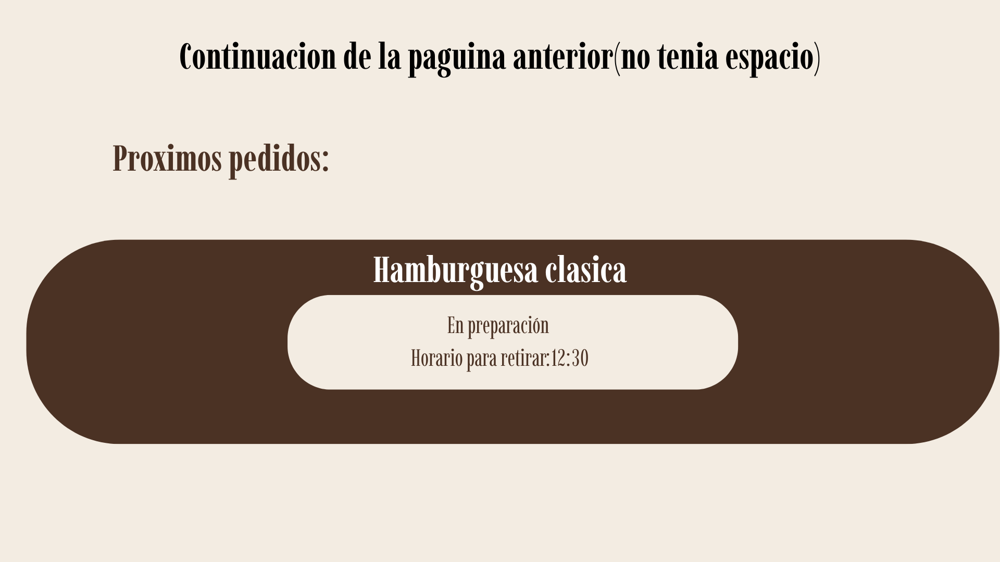
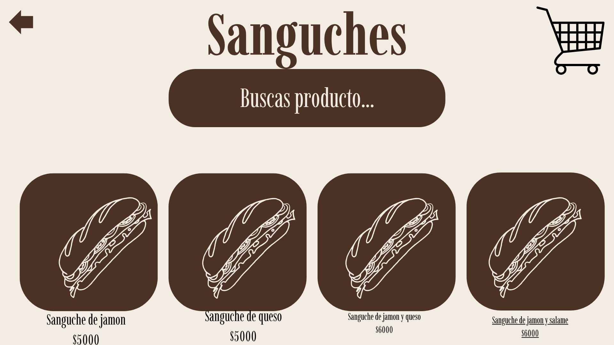
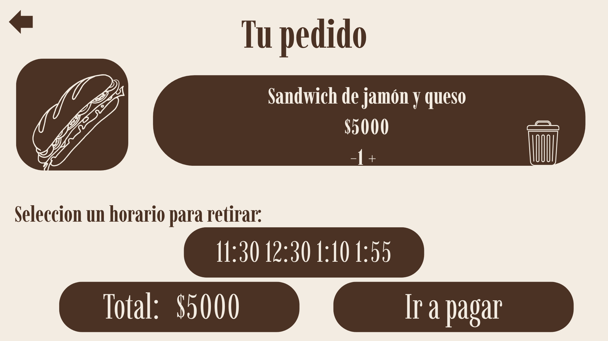
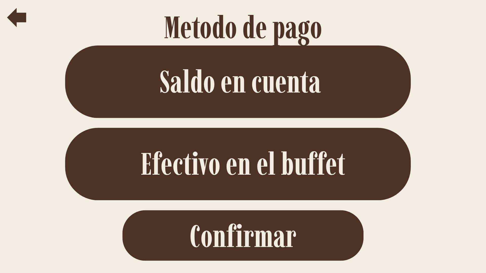
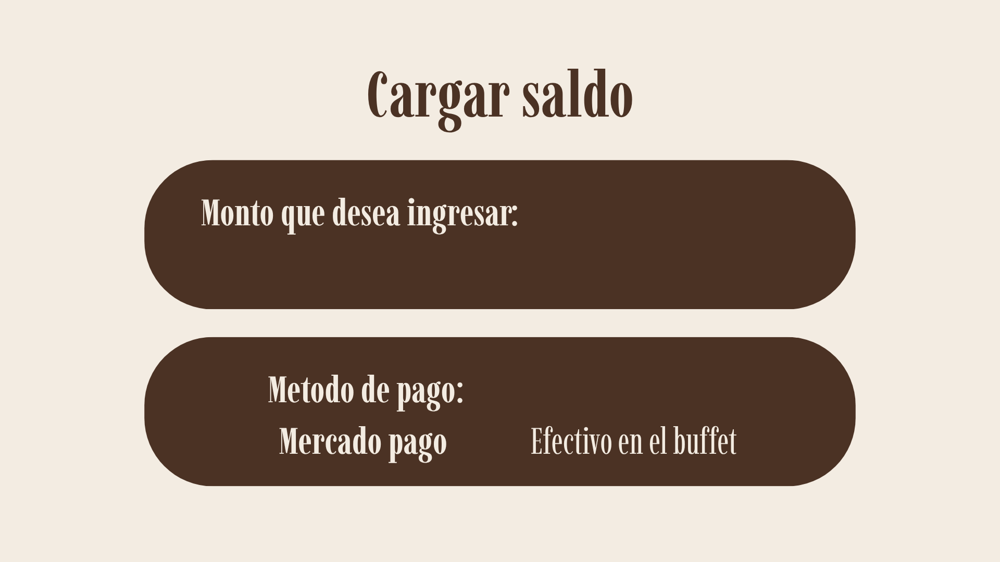

# 2026-TPF-G17
# Buffetazo

## Descripción del proyecto

**Nombre:** Buffetazo

La idea es realizar una aplicación que permita realizar compras vía online en el buffet de la escuela, permitiendo ordenar el almuerzo o algún aperitivo de una manera más ordenada.

## Problemática abordada

El objetivo es que el buffet sea mucho más ordenado, evitando que la gente se amontone y permitiendo que cada alumno tenga más tiempo durante el recreo para comer lo que compró.

Además, en caso de que el buffet tenga pocos recursos, la aplicación podría permitir utilizar menos personal.

## Público objetivo

La aplicación está dirigida a los buffets de diferentes instituciones educativas que tengan esta problemática, principalmente colegios grandes como el nuestro, el Sanfra, el Sagrado, entre otros.

## Objetivo general

Mejorar el flujo y los tiempos del buffet para maximizar el tiempo de recreo y almuerzo.

Esto beneficia al colegio porque evita que los alumnos lleguen tarde al aula y a los alumnos porque tendrán más tiempo disponible durante el recreo.

## Funcionalidades principales

- Registro e inicio de sesión.
- Carga de saldo para realizar pagos.
- Carrito de compras.
- Realización de pedidos.
- Carga de productos por parte del buffet.
- Notificación de alerta cuando el pedido está listo.

## DER

El Diagrama Entidad-Relación se realizará posteriormente, una vez presentada la idea.

## Diseño de la página

## Organización del proyecto

| Tarea | Responsable | Fecha estimada |
|---|---|---|
| Login y Registro | Miranda / Fabiani | 15/10 |
| Cargar saldo y abonar | Miranda / Reddel | 22/10 |
| Cargar y eliminar productos | Fabiani / Poet | 30/10 |
| Carrito de pedidos | Reddel / Poet | 06/11 |
| Notificación de alerta | Miranda / Reddel | 14/11 |
| Probar si funciona y corrección | Todos | 16/11 |
